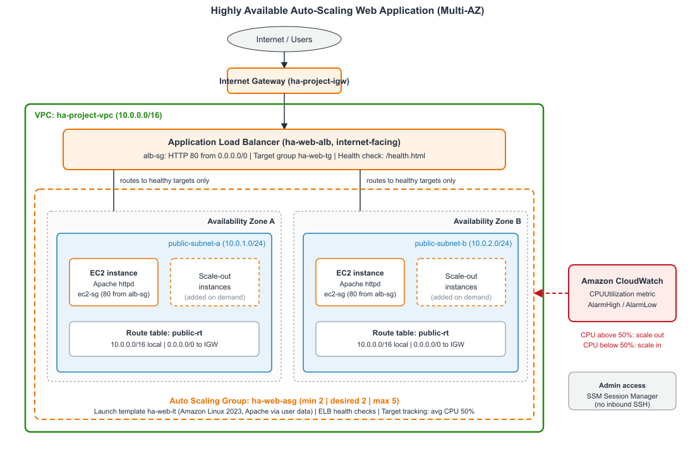
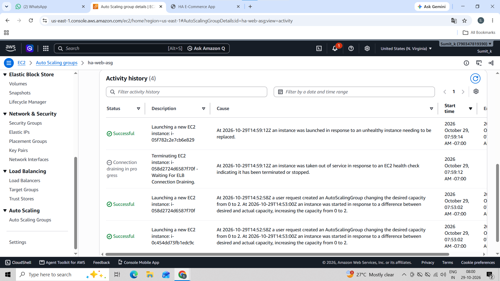
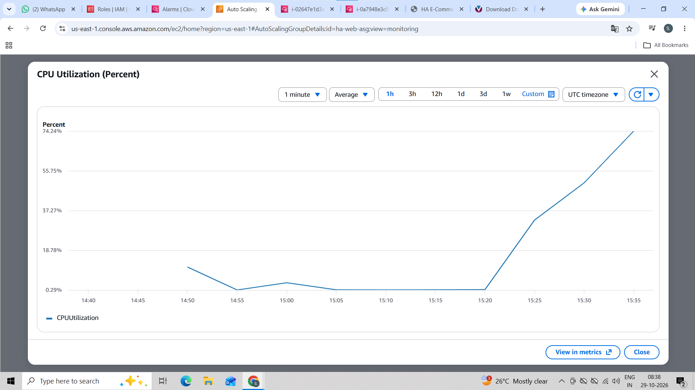
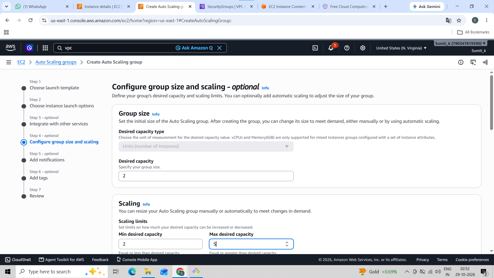
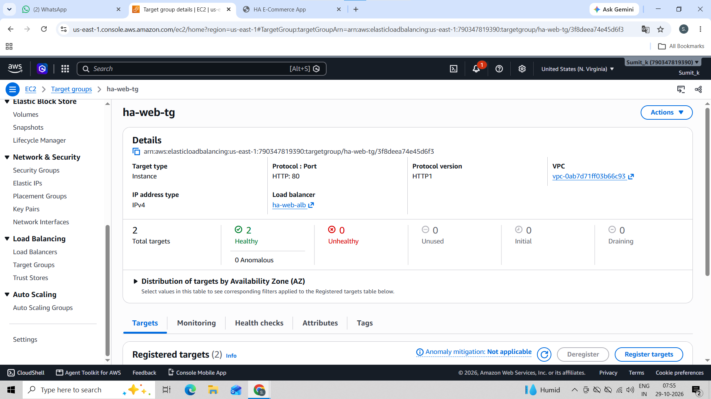
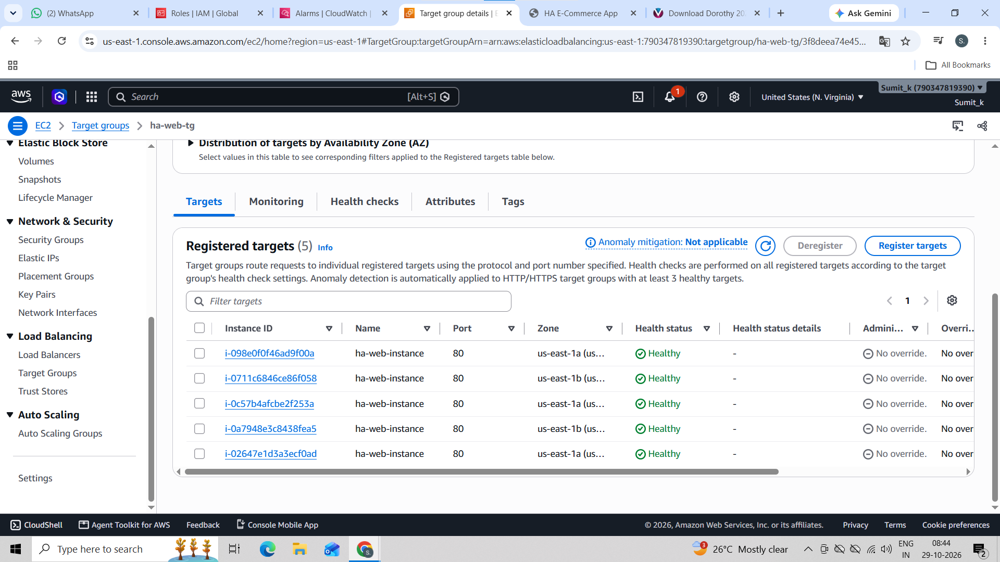
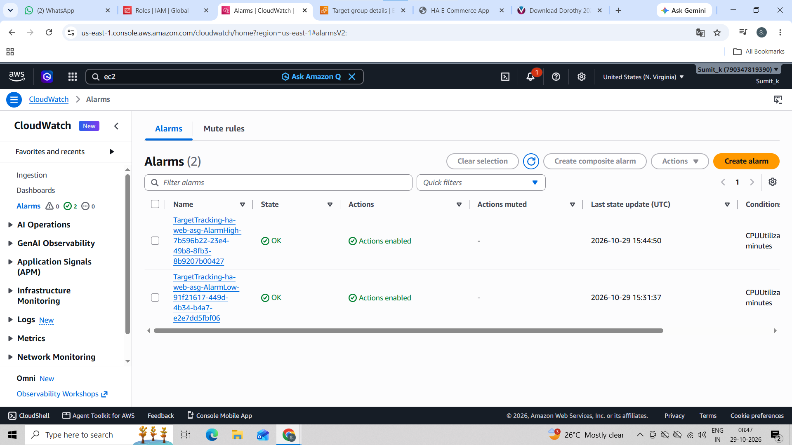
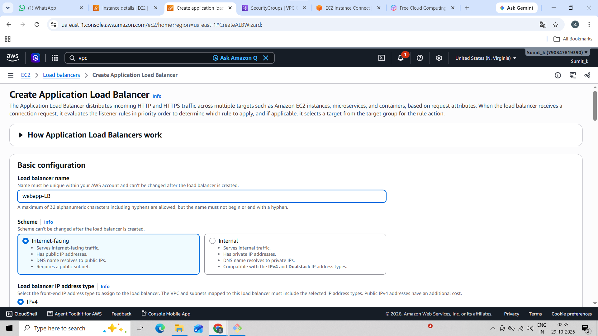
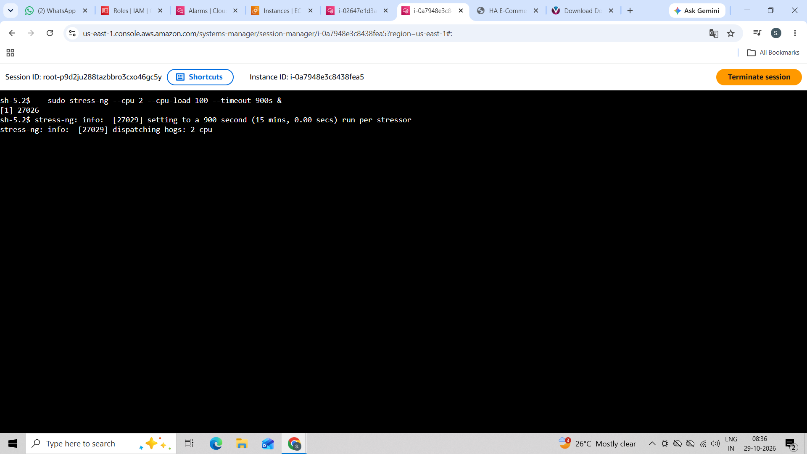

# Highly Available, Auto-Scaling Web Application on AWS

A Multi-AZ web application built with an **Application Load Balancer (ALB)** and an **Auto Scaling Group (ASG)** that adjusts capacity automatically with demand and has no single point of failure.

## 1. Problem Statement

An e-commerce application crashed during peak sales because of traffic spikes. Management asked for an architecture that:

- Adjusts capacity automatically based on demand
- Has zero single points of failure

## 2. Architecture

## Component 

| VPC |

| Public subnets | 

| Internet Gateway |

| Route table |

| Security groups |

| Launch template | 

| Target group | 

| Load balancer | 

| Auto Scaling Group | 

| Scaling policy |

| Monitoring | 

## 3. Implementation Summary

1. **Networking:** created the VPC, two public subnets in different AZs, an Internet Gateway and a public route table.
2. **Security groups:** `alb-sg` allows HTTP from anywhere. `ec2-sg` allows HTTP only from `alb-sg`. SSH port 22 was removed.
3. **Launch template:** user data installs Apache and `stress-ng`, writes a versioned `index.html` showing the app version, instance ID and AZ, and creates `/health.html` for health checks. An IAM instance profile with `AmazonSSMManagedInstanceCore` enables Session Manager.
4. **Target group and ALB:** health check on `/health.html` (interval 15 s, healthy threshold 2, unhealthy threshold 2). The listener on port 80 forwards to the target group.
5. **Auto Scaling Group:** 2 to 5 instances across both subnets, attached to the target group, ELB health checks enabled, 120 s grace period, target tracking policy at 50% CPU.
6. **Versioning:** a new launch template version changes `APP_VERSION`. The ASG uses the new version and an instance refresh rolls it out without downtime.

## 4. Test Results

### 4.1 Failover test

| Step | Observation |
|---|---|
| Baseline | 2 healthy targets, one in each AZ |
| Manually terminated one instance | Application stayed reachable through the ALB DNS name |
| Target group | Terminated instance moved to draining/unhealthy |
| ASG activity | New instance launched automatically, capacity restored to 2 |

Screenshots: 

### 4.2 Load test and scaling validation

| Item | Result |
|---|---|
| Load tool | `stress-ng` on instances (and optionally `ab` through the ALB) |
| Scale-out trigger | CPU above 50% target, `AlarmHigh` entered *In alarm* |
| Capacity change | 2 to `<N>` instances (fill in) |
| Time to scale out | about `<X>` minutes (fill in) |
| Scale-in | After load stopped, `AlarmLow` triggered and capacity returned to 2 (about 15 minutes) |
| Failed requests (ab) | `<value>` (fill in) |

Screenshots:
### 1.CPU utilization graph

### 2. Alarm status while uploding load

 

### 3.Auto scaling group setup

### 4.  Target group status

### 5. Targets

### 6. Alarm status after 

### 7. Load balancer setup

### 8. Aatificial load 

### 9.Webapp homepage

## 5. Challenges and Lessons Learned

- AWS flagged SSH open to `0.0.0.0/0`. I removed the rule and switched to SSM Session Manager.
- New instances start with no load and pull the average CPU down, so scaling may stop below the maximum. This is expected target tracking behaviour.
- Scale-in is deliberately slower than scale-out (about 15 minutes) to avoid flapping.
- A health check grace period is needed so instances are not replaced before Apache finishes starting.

## 6. Possible Improvements

- HTTPS with AWS Certificate Manager and an HTTP to HTTPS redirect
- Private subnets for instances with NAT Gateway or VPC endpoints, leaving only the ALB public
- AWS WAF in front of the ALB
- Scheduled scaling for known sales events
- Database layer with RDS Multi-AZ or Aurora
- CloudFront for caching static content
- Infrastructure as Code (CloudFormation or Terraform)

## 7. Cost and Cleanup

To avoid charges, delete resources in this order:

1. Auto Scaling Group (this terminates the instances)
2. Application Load Balancer
3. Target group
4. Launch template
5. Security groups (after instances are gone)
6. Internet Gateway (detach, then delete)
7. Subnets
8. Route table
9. VPC
10. IAM role `ha-ec2-ssm-role` (optional)

## 8. Technologies Used

Amazon EC2, Auto Scaling Groups, Application Load Balancer, Amazon VPC, Amazon CloudWatch, AWS Systems Manager (Session Manager), IAM, Apache HTTP Server
